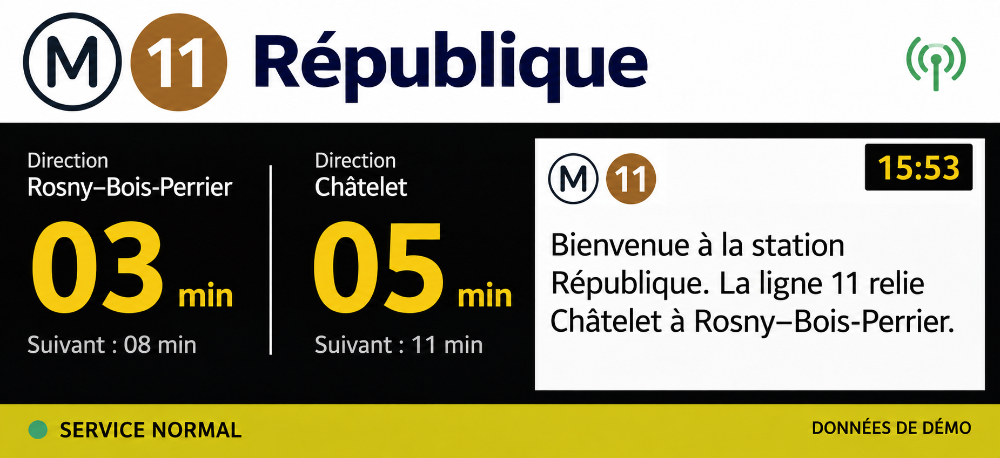

<p align="center">
  
</p>

<h1 align="center">Widget Metro Viewer</h1>

<p align="center">
  Les prochains métros sur ton écran d'accueil.<br />
  Un affichage inspiré des panneaux en station, avec les couleurs de chaque ligne.
</p>

<p align="center">
  <a href="https://github.com/hugobrb/Metro-Widget-Viewer/releases/latest/download/Widget-Metro-Viewer.apk">
    
  </a>
</p>

<p align="center">
  <strong>Android 8.0+</strong> · <strong>16 lignes de métro</strong> · <strong>Données PRIM / IDFM</strong><br />
  <a href="https://github.com/hugobrb/Metro-Widget-Viewer/releases">Toutes les versions</a><br />
  <sub>Le bouton nécessite une release publiée avec un fichier nommé <code>Widget-Metro-Viewer.apk</code>.</sub>
</p>

## Le panneau



*Maquette de référence : les passages, destinations et messages affichés dépendent de la station choisie et des données disponibles.*

## Ce que propose l'app

- **Les prochains passages dans les deux sens**, avec prise en charge des branches et des boucles.
- **Un widget redimensionnable** et un aperçu dans l'application, avec l'heure du téléphone.
- **Les informations trafic** de la ligne et de ses correspondances, regroupées et affichées en rotation.
- **Un catalogue disponible hors connexion** : 16 lignes, dont 3 bis et 7 bis, et 405 couples ligne–station.
- **Une sélection simple** : recherche des stations, ordre de passage et pastilles aux couleurs des lignes.
- **Trois thèmes** : clair, sombre ou automatique selon le téléphone.
- **Des paramètres dédiés** pour le thème et le suivi local des consommations API.

L'actualisation est demandée toutes les minutes lorsque le téléphone est déverrouillé. Android peut différer les travaux en arrière-plan. Le bouton manuel permet de relancer une récupération, avec une protection de 30 secondes contre les clics répétés.

## Installer

1. Télécharger l'APK avec le bouton ci-dessus depuis le téléphone Android.
2. Ouvrir le fichier et autoriser, si demandé, l'installation depuis cette source.
3. Ouvrir l'application, choisir une ligne et une station, puis enregistrer.
4. Ajouter le widget depuis le menu des widgets de l'écran d'accueil.

Pour les **vrais passages**, créer un compte sur [PRIM Île-de-France Mobilités](https://prim.iledefrance-mobilites.fr/), activer les services nécessaires et saisir sa clé dans l'app. Chaque installation utilise sa propre clé.

Sans clé, un **mode démonstration** clairement identifié permet de découvrir le panneau. Avec une clé, une réponse indisponible reste signalée comme telle : aucun horaire fictif ne la remplace.

## Données et confidentialité

La clé PRIM est chiffrée dans le stockage privé Android et exclue des sauvegardes. Elle n'est pas fournie avec l'APK ni enregistrée dans le dépôt. Les compteurs de requêtes sont locaux à l'installation ; ils peuvent différer de la consommation totale du compte PRIM.

Les catalogues embarqués et leurs scripts de mise à jour utilisent des exports publics IDFM, sans clé personnelle. Les scripts calculent leurs chemins depuis le projet et peuvent être lancés depuis un autre ordinateur.

Les données restent soumises à la licence de leur producteur, notamment **ODbL** pour le catalogue des arrêts. Sources et fonctionnement : [Catalogue IDFM](CATALOGUE-IDFM.md) · [Intégration PRIM](IDFM-INTEGRATION.md).

## Développer

Ouvrir la racine du dépôt dans Android Studio et synchroniser Gradle.

| Prérequis | Version du projet |
|---|---|
| Android minimal | 8.0 / API 26 |
| SDK de compilation | Android 37 |
| JDK | 25 |
| Gradle / Android Gradle Plugin | 9.6.0 / 9.5.0 |

Configurer le SDK dans Android Studio ou dans un fichier `local.properties` local, exclu de Git.

```powershell
# Compiler l'APK de test
.\gradlew.bat :app:assembleDebug

# Tests JVM, analyse Android et compilation des tests sur appareil
.\gradlew.bat :app:testDebugUnitTest :app:lintDebug :app:compileDebugAndroidTestKotlin
```

APK généré : `app/build/outputs/apk/debug/Widget-Metro-Viewer-1.0-debug.apk`.
Sur macOS/Linux, utiliser `./gradlew`. Pour exécuter les tests Android, démarrer un émulateur ou connecter un appareil de test et lancer `:app:connectedDebugAndroidTest`. Les tests utilisent des connexions simulées et des clés factices.

### Actualiser le catalogue

Sous Windows :

```powershell
.\actualiser-catalogue.cmd
.\actualiser-references.cmd
```

Le second script nécessite Node.js. Après un prolongement, vérifier également l'ordre des stations et les références des lignes, puis recompiler et réinstaller. Voir [la procédure détaillée](CATALOGUE-IDFM.md).

### Publier un APK sur GitHub

Le bouton de téléchargement utilise les **GitHub Releases**, sans ajouter d'APK à l'historique du code.

1. Dans Android Studio : **Build → Generate Signed App Bundle or APK → APK → release**.
2. Renommer une copie de l'APK signé en **`Widget-Metro-Viewer.apk`**.
3. Sur GitHub : **Releases → Draft a new release**, choisir un tag, par exemple `v1.0.0`.
4. Joindre ce fichier APK et publier une release normale, marquée comme la dernière version ; une simple préversion ne suffit pas pour le lien `/latest`.

Le bouton pointera ensuite vers cet APK. Pour les mises à jour, conserver le même keystore et augmenter `versionCode` dans `app/build.gradle.kts`. La version à publier doit être testée sur téléphone avant diffusion.

Les APK, bundles, fichiers de signature, mots de passe, caches et réglages locaux sont exclus de Git. Ne jamais joindre un keystore ou une clé PRIM à une release.
